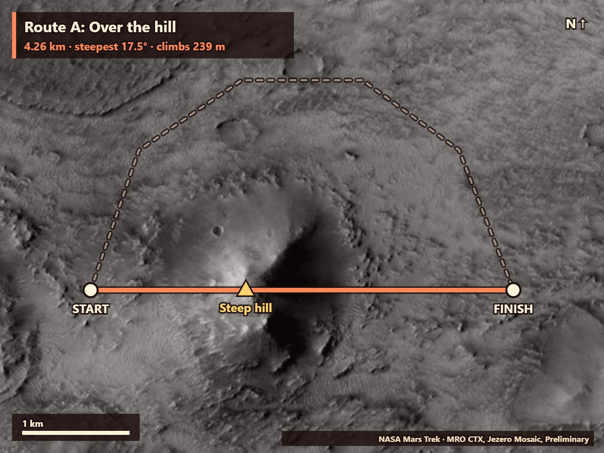

# Mission Trainer: 90 Sols on Mars

A browser game where you play a young astronaut keeping a Mars outpost alive. Land the rocket, set up the base, and fix the problems that decide whether a mission succeeds or fails.

Built for the NASA hackathon challenge **"Build a Junior Astronaut Mission Trainer"**: make the engineering trade-offs of a lunar or Martian outpost tangible and fun for young learners.



## What you do

**Chapter 1: A Place to Live** (playable now; 8 chapters planned)

- Land on Mars, climb out of the rocket and unload the cargo.
- Go through the airlock's air shower and install the server blocks to power up the base.
- Switch on the Mission PC, where Dr. Ian, your coach, helps you read oxygen, water, food, crew energy, radiation, battery and research levels.
- Drive the rover to a research station to find a lost research bot.

**Mission tasks** (also playable on their own from the Tasks menu)

| Task | What you learn |
|---|---|
| Oxygen Rescue | Find an air leak with a scanner and patch it before the cabin loses pressure |
| Water Filter Repair | Shut the valve, swap the worn filter and test the water |
| Solar Sweep | Brush Martian dust off a solar panel to restore power |
| Rock Detectives | Identify basalt, sandstone and conglomerate with a scale, microscope and magnet |
| Choose a Rover Route | Pick between a short, steep road and a long, gentle one, using real NASA data |

## Real NASA data: Choose a Rover Route

On the way to the research station, the road forks at a real hill on the floor of Jezero Crater, where Perseverance is exploring:

| | Distance | Steepest part | Total climb |
|---|---|---|---|
| Route A: over the hill | 4.26 km | 17.5° | 239 m |
| Route B: around the hill | 6.17 km | 5.1° | 95 m |

The game explains what each choice costs (distance, slope, climb and drive time at Perseverance's top speed of about 152 m/h), and the drive changes too: on the hill the rover tilts and its wheels slip.

Data sources:
- [NASA Mars Trek](https://trek.nasa.gov/mars/): map layer *MRO CTX, Jezero Mosaic, Preliminary*; heights from *MGS MOLA and Mars Express HRSC, DEM* via the Elevation Profile service
- [NASA JPL Education: Map a Mars Rover Driving Route](https://www.jpl.nasa.gov/edu/resources/project/map-a-mars-rover-driving-route/)

To re-measure the routes: `python tasks/rover-route/tools/measure_routes.py`

## How to run

No install and no build step. It's plain HTML, CSS and JavaScript.

1. Clone the repository.
2. Open `index.html` in a browser, or serve the folder (recommended, so the embedded tasks work):
   ```bash
   python -m http.server 8000
   ```
   then visit http://localhost:8000.

**Controls:** ← → or A/D to walk · Shift to sprint · Space to jump · E to interact · Esc to go back · W/S to drive the rover · M to mute. Touch controls appear on phones and tablets.

## Built with

- HTML, CSS and vanilla JavaScript (Canvas 2D for the scenes and the rover drive)
- Web Audio API: every sound effect is generated in code, with no audio files
- Python (standard library) for measuring the Mars Trek routes
- WebStorm, Git and GitHub

## Project structure

```
index.html          Game page (launcher, chapter 1, Mission PC)
app.js              Outpost scenes, movement and interactions
rover-drive.js      Rover driving, route fork and research station
sfx.js              All sound effects (Web Audio)
mission-pc.js       Mission PC readings and Dr. Ian's greeting
tasks/              Mission tasks, each in its own folder
tasks/rover-route/  Choose a Rover Route, its data (routes.js) and tools
```
